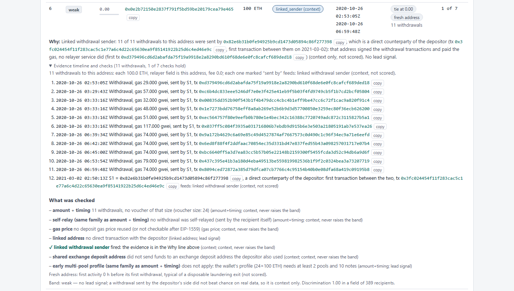
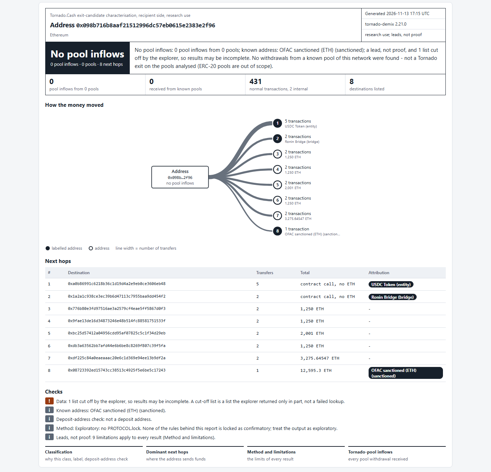
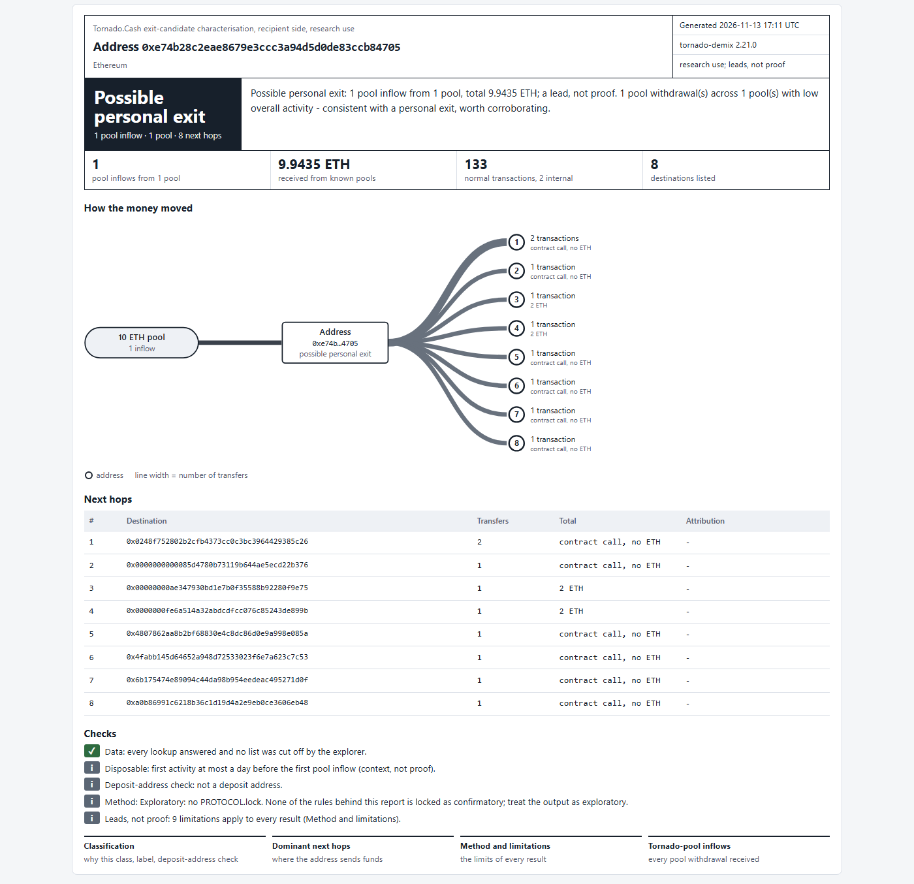
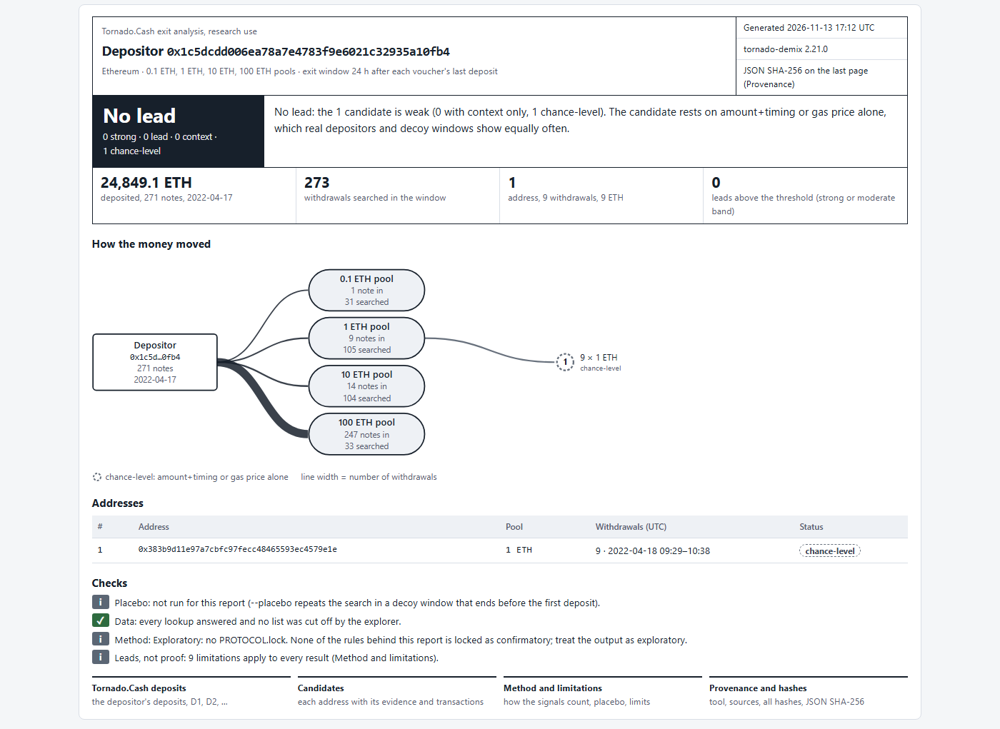
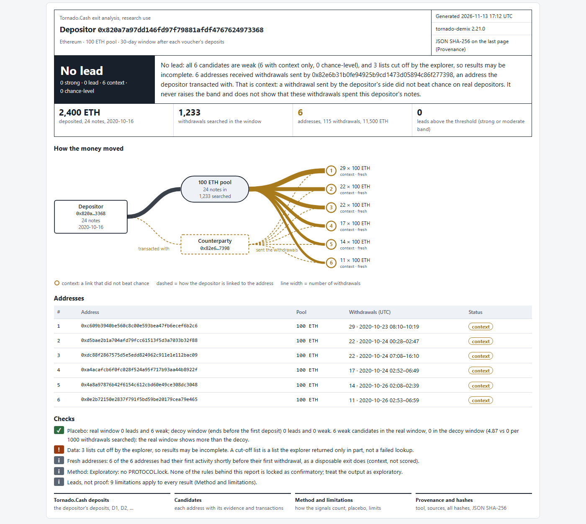
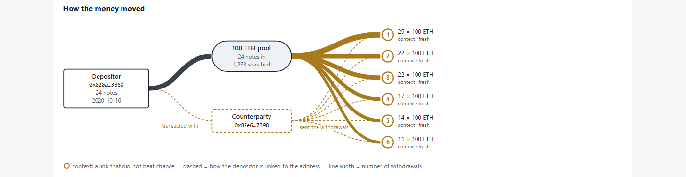
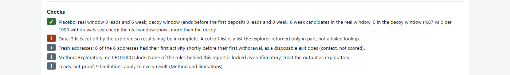
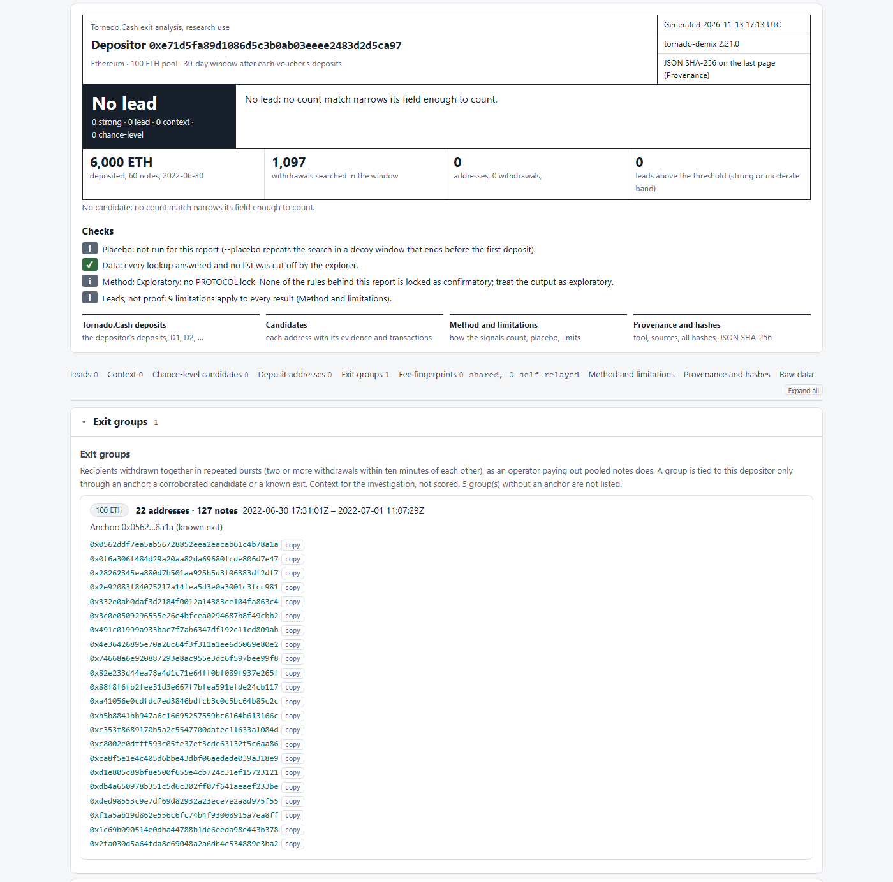
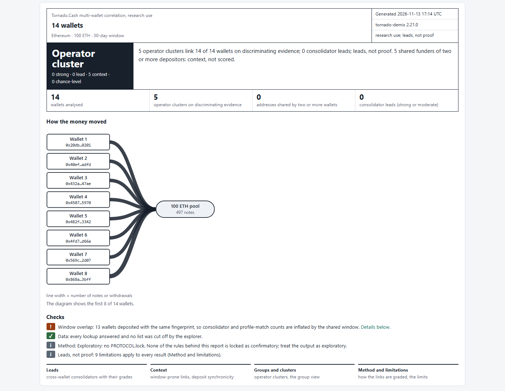
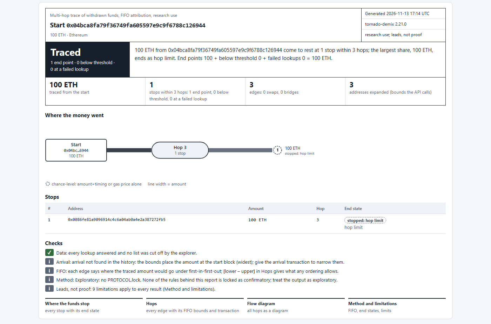

# TornadoCash Demixer

[](https://doi.org/10.5281/zenodo.23085804)
[](https://pypi.org/project/tornado-demix/)

Transaction-linking heuristics for Tornado Cash deposits, using only public on-chain data.
The toolkit ranks candidate withdrawal addresses for a depositor wallet and reports
each candidate with an evidence band and the evidence behind it. A band needs a
lead signal that stood above chance on real depositors: a linked address (a direct
counterparty whose first withdrawal came within 72 hours of the deposit) or an
early multi-pool profile match; two independent
lead sources make a band `strong`. Amount+timing and gas-price matches turn up as
often by chance as for real exits, so they are shown as context and never raise
a band. It also groups exits paid out together, groups wallets of one operator
by shared candidates and follows withdrawn funds forward.

Output is a set of leads for further investigation, not proof. Tornado Cash breaks
the deposit-withdrawal link cryptographically; the tool looks for behavioural
traces users leave around it.

## What it does

- Finds a wallet's deposits into the 56 registered pools on 8 EVM networks
  (native transfers, internal transfers from contract wallets, ERC-20 transfers,
  direct or through a router).
- Groups deposits into vouchers (one pool, one session, `--gap-hours`, default 24)
  and gives each voucher its own withdrawal search window.
- Reads the pools' `Withdrawal` events in those windows and counts how many
  withdrawals each recipient received. A recipient that received exactly *N*
  withdrawals matches a voucher of *N* notes.
- Scores every recipient: a count match weighted by how much of the recipient
  field it eliminates (`disc`; counted only at `disc >= 0.5` in a field of at
  least 5 recipients), self-relayed withdrawals, reuse of a deposit gas price
  (only on withdrawals the user sent, and only in blocks without an EIP-1559 base
  fee), direct transactions with the depositor (not counted when the counterparty
  is a contract; a lead only when the recipient's first withdrawal came within 72
  hours of the last deposit, otherwise shown as a late direct link, context), and an early multi-pool profile: a recipient that received the
  wallet's full note profile over two or more pools (10+ notes) within 72 hours of
  the last deposit in each pool.
- Labels each listed deposit address as an exchange deposit, a service deposit, an operator-run forwarder or an ERC-4337 smart account; only the exchange kind can link two addresses, and it is context only.
- Reports a band per candidate: `strong` (lead signals from two independent sources:
  early direct link and early multi-pool profile), `moderate` (a lead signal
  from one source), `weak` (amount+timing, gas price and/or context-only
  signals, which never raise the band — chance-level on
  real depositors, see the [placebo test in EVALUATION.md](https://github.com/prettydeath/TornadoCash-demixer/blob/main/docs/EVALUATION.md) for details), with the evidence behind it: every family, whether it holds,
  and the numbers (share of the recipient field with the same count, `disc`,
  gas price). Candidates are ordered by band, then by an uncalibrated noisy-OR
  score taken across evidence families (within a family only the strongest
  signal counts). Reports state the analysis parameters and the block ranges read.
- Marks the top candidates that had at most a day of history before their first
  withdrawal (fresh, disposable exits; shown as context, never scored).
- Groups exits withdrawn together in repeated bursts, the payout rhythm of an
  operator that pooled several deposits; a group is listed when a corroborated
  candidate or an exit you already know (`--known-exit`) anchors it.
- Finds the depositor's exchange deposit addresses and flags a recipient that
  sent funds to the same one (`shared_deposit`). Since 2.21 this is context
  only: it is shown in the evidence but has no weight and never raises the band
  (a post-hoc change, decided after the second hold-out and not tested on new data).
  On 1,000 random depositors it gave 27 real-window against 4 decoy hits when
  the deposit address swept to labelled exchange wallets (rule 2.17 sample), but
  in the second hold-out it was not above chance at 30 days (Ethereum 18 target
  against 30 decoy leads, R 1.77, interval 0.16-3.91; Polygon 23 against 13,
  R 0.58, 0.00-3.16); at 72 hours it was 14 against 2 and 23 against 0. The
  decoy leads came from deposit addresses with many senders, which are shared,
  not per customer.
- Marks a linked exit that withdrew within 72 hours of the deposit (early exit).
  Since 2.17 a direct link is a lead only then: on 302 random Ethereum depositors
  a direct link first withdrawn within 72 hours was a lead 26 times in real
  windows against once in decoy windows, a later one 8 against 13, chance level.
  A later direct link is listed as context and never raises the band or the
  score. Since 2.19 a withdrawal sent by
  the depositor's side (`linked_sender`) is context too: it did not separate from
  chance in any placebo sample. Since 2.21 so is a shared exchange deposit
  address (see above).
- Optionally excludes withdrawals by their Merkle root (`--root-check`, or the "Merkle-root
  check" box in the web UI; exploratory, off by default). A withdrawal proof names the root
  it was built against; if that root held none of the depositor's notes in the pool the
  withdrawal cannot be theirs. A candidate with every withdrawal excluded leaves the ranking
  and is listed as "excluded by Merkle root"; one with some withdrawals removed is recounted and carries
  the context signal `root_excluded` (or is listed as dropped after recount if it loses its count match); one whose notes were only partly in the tree carries `root_partial` and nothing is removed. It is not a lead and is not scored. It needs one
  transaction lookup per candidate withdrawal (at most 200) and a per-pool root index (about
  30 minutes to build for a large pool, then cached). See
  [METHODOLOGY.md](https://github.com/prettydeath/TornadoCash-demixer/blob/main/docs/METHODOLOGY.md) section 4c and the measurement in
  [EVALUATION.md](https://github.com/prettydeath/TornadoCash-demixer/blob/main/docs/EVALUATION.md#merkle-root-exclusion-exploratory).
- Optionally runs a placebo check (`--placebo`, or the web UI option): the same
  analysis on a decoy window that ends before the wallet's first deposit, so the
  report shows how many leads chance alone produces for this wallet.
- Opens the HTML report with a case overview and a flow diagram: depositor, pools,
  candidate exits coloured by band.
- For several wallets: shared candidates, denomination-profile matches,
  cross-wallet consolidators graded against the window-overlap artefact, deposit
  synchronicity, shared private funders, and operator clusters (union-find on
  discriminating edges only).
- Traces split exits one hop forward to a common collection address (`cluster`).
- Follows withdrawn funds forward over several hops with FIFO attribution and
  DEX-swap resolution, up to a labelled service (`trace`); each edge shows
  `FIFO amount [lower - upper]`, the share the traced funds can have under any
  ordering; every address has one ledger, so a transfer reached by several branches
  is attributed once, and FIFO starts at the traced arrival. A deposit into an Across SpokePool (V3 and current events only) is
  followed to the destination chain by its on-chain deposit id; an Arbitrum Inbox
  deposit (retryable ticket or `depositEth`) is followed on Arbitrum from its L2
  recipient once the L2 credit is found, and a ZKsync Bridgehub request shows its L2
  recipient (ZKsync chains are not followed); `--arrival-tx`
  fixes the transaction that brought the start amount, which narrows the bounds.
- Characterises an exit candidate: activity, pool inflows, next hops, a disposable
  flag, optional address labels and the deposit-address check of each listed address
  (`characterize`).
- Checks whether one address behaves like a deposit address: exchange, service or
  deposit-like (unlabelled sweep target), forwarder or smart account (`classify-address`).

The method, thresholds and the reasoning behind them are in
[docs/METHODOLOGY.md](https://github.com/prettydeath/TornadoCash-demixer/blob/main/docs/METHODOLOGY.md).

## Components

| Module | Role |
|---|---|
| `tornado_demix/demix.py` | deposit detection, vouchers, search windows, withdrawal counting |
| `tornado_demix/heuristics.py` | signals, `count_discrimination`, noisy-OR score, bands |
| `tornado_demix/multi.py`, `graph.py` | multi-wallet correlation, consolidator grading, clustering |
| `tornado_demix/cluster.py` | one-hop tracing of split exits, on-disk cache |
| `tornado_demix/groups.py` | exit groups from joint withdrawal bursts |
| `tornado_demix/trace.py` | multi-hop FIFO tracing of withdrawn funds with swap resolution |
| `tornado_demix/characterize.py`, `attribution.py` | recipient-side analysis, address labels |
| `tornado_demix/etherscan.py`, `rpc.py`, `events.py` | explorer client, JSON-RPC probes, event decoding |
| `tornado_demix/networks.py`, `pools.py`, `data/networks.csv` | verified pool registry |
| `tornado_demix/report.py` (`report_csv`, `report_html`, `report_json`) | CSV, self-contained HTML and JSON reports |
| `tornado_demix/cli.py`, `webui/app.py` | command line and local Flask UI over the same functions |
| `tools/verify_pools.py` | on-chain verification of registry entries |
| `tools/calibrate.py` | precision/recall against confirmed cases (needs private data) |
| `tools/sensitivity.py` | ranking stability of saved results under perturbed weights |
| `tools/simulate.py` | synthetic benchmark: ablation, negative controls, counter-measures — [results](https://github.com/prettydeath/TornadoCash-demixer/blob/main/docs/EVALUATION.md) |
| `tools/real_cases.py` | the method on two public laundering cases (KuCoin, Harmony) |
| `tools/ens_labels.py`, `tools/evaluate_labels.py` | an ENS-labelled set of depositor/exit pairs and the evaluation on it — [results](https://github.com/prettydeath/TornadoCash-demixer/blob/main/docs/EVALUATION.md#a-labelled-set-from-ens) |
| `tools/wang_baseline.py` | the ENS set scored under the Wang et al. (2023) protocol, with their H2/H3/H5 re-implemented |
| `tools/placebo_eval.py`, `tools/placebo_windows.py` | placebo (target-decoy) test on random real depositors, per evidence family and exit window — [results](https://github.com/prettydeath/TornadoCash-demixer/blob/main/docs/EVALUATION.md#placebo-test-on-real-depositors) |
| `tools/placebo_dar.py`, `tools/placebo_dar_universe.py` | placebo test of the shared exchange-deposit-address signal on the cached runs and on 1,000 depositors read from the ENS universe |
| `tools/root_ceiling.py`, `tools/root_exclusion_eval.py` | upper bound and placebo measurement of the Merkle-root exclusion on the cached runs |
| `tools/review_sample.py` | a blinded manual-review sheet of leads and hidden controls, and its scoring |

## Requirements

- Python 3.9 or newer. Runtime dependency: `requests`. The web UI adds `flask`.
- An Etherscan V2 API key. On the free plan it covers Ethereum, Polygon and
  Arbitrum; Optimism is served by Blockscout and Avalanche by Routescan, neither
  needing a key. Base goes through Etherscan when the key's plan serves it and
  otherwise switches to keyless Blockscout, which throttles heavy use. BNB Smart
  Chain and Gnosis need a paid Etherscan plan: the free tier does not serve them. Where a provider has no
  `proxy` module (Blockscout), the client reads the head block from Blockscout's
  `block` module and falls back to the network's JSON-RPC node.
- The Tornado proxy `0x0D5550d5...9b17` is registered for Polygon, Avalanche,
  Arbitrum, Optimism, Gnosis and Base, so deposits made through it are detected
  there (before, an Arbitrum wallet with 4 proxy deposits showed 0). BNB Smart
  Chain has none: no deposit could be sampled with free data sources.

## Installation

From PyPI (the `tornado-demix` command and the pool registry):

```bash
python -m pip install tornado-demix
```

The web UI and the evaluation tools live in the repository. From a checkout:

```bash
python -m pip install .            # core: the tornado-demix command and the pool registry
python -m pip install ".[web]"     # plus Flask; run the UI from a checkout
python -m pip install -e ".[dev]"  # for development: tests and ruff
python -m pip install -e ".[eval]" # plus numpy, scipy, statsmodels: the evaluation tools
```

Dependencies and their version bounds are declared in `pyproject.toml`.

## Configuration

Copy `config/api.csv.example` to `config/api.csv` and put your key in it, or set
`ETHERSCAN_API_KEY`:

```csv
service,api_key
etherscan,YOUR_KEY
```

Config files are looked up in `$TORNADO_DEMIX_CONFIG` (only there, when set),
then `./config/`, then the repository's `config/`. One directory per case keeps
case inputs apart. `config/wallets.csv` (column `address`) can replace addresses
on the command line. `config/networks.csv`, if present, overrides the bundled
registry.

### Labels (attribution set)

The shared exchange deposit address signal is context only since 2.21, labels or
not. Exchange labels still decide which deposit addresses are listed as swept to a
labelled exchange: with them, the placebo test gave 27 real-window against 4 decoy
hits on 1,000 depositors (before the second hold-out); without them, deposit
addresses found by activity alone sit at chance (16 against 12) and are shown as
context only. To load the public label set (about 88,000 Ethereum addresses, 26,000 of
them exchange labels):

```bash
tornado-demix labels fetch                    # all 8 networks
tornado-demix labels fetch --network bsc      # one network
tornado-demix labels status                   # what is loaded
```

Files go to `$TORNADO_DEMIX_ATTRIBUTION` if set, else `config/attribution/`
(`--dir` overrides), one `<network>.csv` per chain; that is where lookups read
them. The web UI shows the same download as a button when a demix result has no
labels for its network. Nothing is downloaded unless you run the command, and the
data is not bundled: it is third-party, and each upstream source keeps its own
licence (see below).

### Address labels (optional)

Opt-in extra source: `tornado-demix labels blockscout --network polygon --addresses-file F` caches Blockscout metadata tags (needs the `labels` extra), and `--labels-blockscout` or the web checkbox uses them; see METHODOLOGY 7a for lineage.

Labels are not bundled. The tool reads one `<network>.csv` per chain
(`ethereum.csv`, `bsc.csv`, ...) with an `address` column and optionally `entity`,
`label`, `category`, `source`, `confidence`, from the directory given by
`--attribution-dir` or `TORNADO_DEMIX_ATTRIBUTION`.

A ready dataset in this format is
[prettydeath/wallet-attribution](https://github.com/prettydeath/wallet-attribution):
about 115,000 addresses (exchanges, OFAC-sanctioned entities, scams, mixers,
bridges, DeFi) on 47 networks, covering all eight networks of this tool.

```bash
git clone https://github.com/prettydeath/wallet-attribution
python -m tornado_demix characterize <address> --attribution-dir wallet-attribution/data
```

It is aggregated from public sources: the OFAC SDN address list (US government
public record, via 0xB10C/ofac-sanctioned-digital-currency-addresses),
dawsbot/eth-labels, tradezon/cex-list, MyEtherWallet/ethereum-lists and the
proof-of-reserves wallets in DefiLlama-Adapters. The dataset's code is MIT; each
label keeps the license of its upstream source, so check those before
redistributing labels or using them commercially.

Labels are only displayed. They never change a score or a band, and a label is
a claim by its source, not a finding of this tool.

## Command line

```bash
# one wallet: CSV files, an HTML report and the full result as JSON
python -m tornado_demix demix 0x1234567890abcdef1234567890abcdef12345678 \
    --network ethereum --out-dir out/demix --report out/demix.html --json out/demix.json

# narrow the search to 6 hours after each voucher's last deposit
python -m tornado_demix demix <wallet> --exit-window 6

# list the exit group of an exit already known from the investigation
python -m tornado_demix demix <wallet> --known-exit <exit address>

# also run the same analysis on a decoy window before the first deposit
python -m tornado_demix demix <wallet> --placebo

# a 7-day exit window, as seen in public laundering cases
python -m tornado_demix demix <wallet> --rapid

# several wallets
python -m tornado_demix multi <wallet1> <wallet2> --report out/multi.html
python -m tornado_demix multi --wallets-csv config/wallets.csv
# intermediate wallets of one actor, also treated as one depositor (conditional on that assertion)
python -m tornado_demix multi <wallet1> <wallet2> --group --json out/multi.json

# split exits, one hop forward (resumable cache in --cache-dir)
python -m tornado_demix cluster <wallet> --cache-dir .cache/case-42

# describe an exit candidate
python -m tornado_demix characterize <address> --attribution-dir path/to/labels

# is this address a deposit address (exchange / service / deposit-like), a forwarder or neither?
python -m tornado_demix classify-address <address> --network polygon --labels-blockscout --json out/c.json

# follow 10 ETH withdrawn to <address> in block 12000000 over up to 4 hops
python -m tornado_demix trace <address> --amount 10 --start-block 12000000 --report out/trace.html
```

Provider flags, shared by every command that reads the chain:

- `--max-wait SECONDS` (default 120): the longest one call backs off on a transient
  error (rate limit, HTTP 429/5xx, timeout), with exponential waits and jitter.
  Permanent errors (rejected key, a chain the plan does not cover, a malformed
  address) fail on the first answer with a one-line message.
- `--pause SECONDS`: wait before every explorer call, for a free key shared with
  other programs.
- `--http-cache DIR`: keep explorer answers in DIR and reuse them. Only account and
  log queries that end at least 64 blocks below the chain head are stored (such
  rows no longer change); errors, partially indexed answers and the API key are
  never stored.
- `--progress-every N` (default 50): a `[*]` line on stderr every N explorer calls.
- On a network with an `rpc_url` in `networks.csv`, `getLogs` falls back to JSON-RPC
  `eth_getLogs` when the explorer fails after its retries (for example Blockscout
  throttling). The node is asked in block spans that shrink when it reports a range
  limit; block timestamps come from `eth_getBlockByNumber`. A log row read from a node
  has no gas price, so the unique-gas-price signal has nothing to match on it; every
  such list is listed as a notice ("read from the RPC node") in the CLI, HTML, JSON and
  web output. `--max-wait` bounds the wall time of one call, request timeouts included.

`python -m tornado_demix <command> --help` lists every option. A configuration or
provider error exits with a non-zero status and a one-line message. Progress goes
to stderr; the summary to stdout.

### Reading the report

The HTML report and the web UI share one layout. The **verdict card** on top answers in one sentence and counts leads, context-only and chance-level candidates and failed lookups (plus the placebo verdict and the exploratory and limitations badges).
Sections follow in a fixed order: **Leads** (open), then Context, Chance-level candidates, Deposit addresses, Groups and clusters, Fee fingerprints, Method and limitations, Raw data (collapsed; counts in the sticky table of contents).
**strong**: lead signals from two independent sources (an early direct link and an early multi-pool profile); **moderate**: one lead source.
**weak**: no lead signal, either with a context-only signal (late direct link, withdrawal sender, shared deposit address) or on amount+timing and gas price alone, which are chance-level; the score only orders candidates within a band.
Each candidate row opens an evidence timeline with full hashes; a trace ends with a totals line (end points + below threshold + failed lookups = start amount).
Filters, search and copy buttons need JavaScript; without it every row is still in the page, and printing expands every section.

## Web UI

```bash
python webui/app.py      # http://127.0.0.1:5000
```

The form runs the same six analyses (the sixth, classify, is the deposit-address check of one address); each mode shows only its own fields, and an input error is shown next to its field. The results page is the HTML report itself (same layout, see below): for each demix candidate an
**Evidence timeline** lists the deposits, the withdrawals and every evidence family that was checked, whether it
holds, and the numbers behind it. **Analysis parameters** (under Method and limitations) lists the assumptions
(voucher gap, window, thresholds) and the block ranges read. The HTML report, the
JSON result and the CSV table can be downloaded. With JavaScript on, a run
goes to a background thread and the page shows a live status (elapsed time, explorer
calls, cache hits, time spent waiting on the provider); without it the request runs
to completion as before. One background run goes at a time (they share the API key's rate limit). The form's *Provider settings* are the flags above.

For `trace`, enter one exit address, the amount to follow and optionally the
block the funds arrived in, an ERC-20 token and the number of hops (up to 8). The
page lists where the traced funds stop and why (labelled address, hop limit, a
contract that paid nothing back, not moved on, `lookup_failed`, `below_threshold`,
`tornado_redeposit`) and every edge with its attributed amount, swaps included; the
HTML report, CSV and JSON can be downloaded. When a lookup failed, every analysis
shows "N lookups failed — results may be incomplete" with the list.


*A demix run on the KuCoin depositor (case 4 below): one candidate row with its expanded evidence timeline (the 11 withdrawals and the counterparty link) and the list of every check that was made. The only check that holds is the withdrawal sent by the depositor's counterparty; it is context, so the candidate stays `weak`.*

The UI binds to localhost and has no authentication (forms carry a CSRF token); see
[SECURITY.md](https://github.com/prettydeath/TornadoCash-demixer/blob/main/SECURITY.md).

## Documented cases

Five public cases with an external source of truth. Each can be re-run from the
addresses shown (an Etherscan API key is enough; the Ronin labels need an
attribution set). The screenshots are from the web UI; the CLI prints the same
results. There is no script in the repository that regenerates the images; most show the first page of the report (verdict, four figures, the diagram of how the money moved, the address table and the checks). A new run can show slightly different counts as the chain grows and open
search windows are clamped to the current block.

| # | Case | Analysis | What it shows | Source of truth |
|---|---|---|---|---|
| 1 | Ronin Bridge 2022 | `characterize` | OFAC-labelled exploiter, bridge and USDC calls, 12,595 ETH to a second sanctioned address | [OFAC, 14 Apr 2022](https://ofac.treasury.gov/recent-actions/20220414) |
| 2 | Wintermute 2022 | `characterize` | one 9.9435 ETH inflow from the 10 ETH pool; a disposable address | [Merkle Science](https://www.merklescience.com/blog/hack-track-analysis-of-wintermute-attack) |
| 3 | Beanstalk 2022 | `demix --exit-window 24` | 271 deposits in three hours; no candidate above `weak` | [Merkle Science](https://www.merklescience.com/blog/hack-track-analysis-of-beanstalk-flash-loan-attack) |
| 4 | KuCoin 2020 | `demix` | 6 of the attacker's 35 exits in the window found through the linked withdrawal sender (context only since 2.19) | [tayvano/lazarus-bluenoroff-research](https://github.com/tayvano/lazarus-bluenoroff-research) |
| 5 | Harmony 2022 | `demix --known-exit`, `multi`, `trace` | an exit group from one known exit; 14 depositors in 5 funder clusters; a three-hop trace | [tayvano/lazarus-bluenoroff-research](https://github.com/tayvano/lazarus-bluenoroff-research) |

Attributing the Ronin, KuCoin and Harmony thefts to Lazarus is the conclusion of
government and industry investigators, not of on-chain analysis; the identity of
the Wintermute and Beanstalk attackers is not established.

### 1. Ronin Bridge exploiter

```bash
python -m tornado_demix characterize 0x098B716B8Aaf21512996dC57EB0615e2383E2f96
```

The exploiter received nothing from a Tornado pool; `characterize` shows where
its funds went next. With the attribution set loaded, the address itself and the
12,595.3 ETH destination are labelled OFAC-sanctioned, and the contract calls go
to Circle: USDC and the Ronin Bridge. Without labels the same hops are shown
unlabelled.


*First page of the `characterize` report for the Ronin exploiter: verdict "No pool inflows", the diagram of the eight next hops with USDC and the Ronin Bridge labelled, and the table ending in the 12,595.3 ETH transfer to a second sanctioned address.*

### 2. Wintermute attacker

```bash
python -m tornado_demix characterize 0xe74b28c2eAe8679e3cCc3a94d5d0dE83CCB84705
```

One inflow of 9.9435 ETH from the 10 ETH pool on the day of the attack
(2022-09-20), the first activity of the address: it is flagged as disposable, the
pattern of 98.6 % of laundering exits in the MixLaunder cases.


*First page of the `characterize` report for the Wintermute attacker: one 9.9435 ETH inflow from the 10 ETH pool, verdict "Possible personal exit", the eight next hops and the checks (the address was fresh, so it is flagged disposable as context).*

### 3. Beanstalk attacker

```bash
python -m tornado_demix demix 0x1c5dCdd006EA78a7E4783f9e6021C32935a10fb4 --exit-window 24
```

271 deposits (247 x 100, 14 x 10, 9 x 1 and 1 x 0.1 ETH) within about three
hours. With a 24-hour exit window the count match leaves one `weak` candidate and
nothing corroborated: a careful operator leaves no lead, and the tool says so
rather than naming an unrelated address.


*First page of the `demix` report for the Beanstalk attacker: 271 notes, verdict "No lead", and the one candidate, a `weak` count match at chance level.*

### 4. KuCoin hack (2020)

```bash
python -m tornado_demix demix 0x820a7a97dd146fd97f79881afdf4767624973368
```

The attacker called `withdraw()` itself from two addresses (Koh, 2020): 451
withdrawals to 36 exits. No exit received a voucher-sized count, so the count
match finds nothing. The depositor had transacted with one of the callers,
`0x82e6...`, so every withdrawal it sent marks its recipient (`linked_sender`): 6
true exits. Before 2.19 they were `moderate` leads; since 2.19 they are listed as
context and the band stays `weak`. The 30 exits of the other caller, which is not a
counterparty of the depositor, are not found; how many of them carry this
depositor's notes rather than the attacker's other deposits is unknown. The report opens with
a flow diagram from the depositor through the pool to the candidates.


*First page of the `demix` report for a KuCoin depositor: verdict "No lead", the six addresses that received withdrawals sent by the depositor's counterparty (`linked_sender`), the diagram and the checks. All six are `weak`, context only; before 2.19 they were `moderate`.*


*"How the money moved" in the same report: the depositor, the 100 ETH pool, the counterparty (dashed) and the six addresses, each with the number of withdrawals it received.*

With `--placebo` the same analysis also runs on a decoy window that ends a day
before the first deposit, where no withdrawal can spend this depositor's notes:


*The Checks list of the same report. The Placebo line reads: six `weak` candidates in the real window, none in the decoy window (4.87 vs 0 per 1000 withdrawals searched); the six are context only (`linked_sender`), so they are not counted as leads.*

### 5. Harmony Bridge hack (2022)

Investigators listed 14 depositors and 55 withdrawal addresses. The attacker
pooled 857 notes of the 100 ETH pool and paid them out mostly six at a time, so
the count match finds no exit and no false one. Three other analyses do.

**Exit groups.** Starting from one exit known from the investigation, `demix`
lists the recipients paid out in the same bursts:

```bash
python -m tornado_demix demix 0xe71d5fa89d1086d5c3b0ab03eeee2483d2d5ca97 \
    --known-exit 0x0562ddf7ea5ab56728852eea2eacab61c4b78a1a
```


*The verdict ("No lead" for this depositor) and the Exit groups section of the report: one group of 22 addresses, 127 notes, paid out in joint bursts and anchored by one known exit. Across all depositors, one known exit gives 23 addresses on average, 73 % of them on the investigators' list.*

**Shared funders.** Correlating the 14 depositors links all of them through five
immediate funders, each of which was paid directly by the bridge exploiter
`0x0d04...ded00`; a sixth, busy funder is left out:

```bash
python -m tornado_demix multi --wallets-csv docs/cases/harmony_depositors.csv
```


*First page of the `multi` report for the 14 Harmony depositors: verdict "Operator cluster" (5 clusters link 14 of 14 wallets through shared funders), the diagram of the first 8 wallets and the pool, and the checks.*

**Trace.** From an exit, `trace` follows the 100 ETH it received forward:

```bash
python -m tornado_demix trace 0x04bca8fa79f36749fa605597e9c9f6788c126944 --amount 100 --max-hops 3
```


*First page of the `trace` report from a Harmony exit: 100 ETH, 3 edges, one stop at the hop limit, with the flow diagram and the checks.*

### More public cases (2021-2025)

Six further incidents with named depositors and published exit lists, run with the
default settings (`demix`, 30-day window; `multi` without options). The exit lists
come from investigators who matched by timing, amount and denomination, so they are
not independent ground truth for this tool: "found" would mean agreement with their
matching, not validation. Only the Deribit depositors come from a sworn document, the
DOJ civil forfeiture complaint (D.D.C. 1:24-cv-02828). Result in short: the known
exits fall inside the searched window almost every time, but only one of them (Garden
Finance) was found, as a `weak` candidate at chance level. The table with the counts
is in [docs/EVALUATION.md](https://github.com/prettydeath/TornadoCash-demixer/blob/main/docs/EVALUATION.md).

| Incident | Depositor(s) | Source |
|---|---|---|
| Steadefi, Aug 2023 | `0xe10d4a5bd440775226c7e1858f573e379d0aca36` | [steadefi.md](https://github.com/tayvano/lazarus-bluenoroff-research/blob/main/hacks-and-thefts/steadefi.md); UN Panel of Experts report S/2024/215 |
| Coinshift, Aug 2023 | `0x68c4a151d436ec1c5448d225a97bd19cce4dfed0` | [coinshift.md](https://github.com/tayvano/lazarus-bluenoroff-research/blob/main/hacks-and-thefts/coinshift.md); [ZachXBT](https://zachxbt.mirror.xyz/B0-UJtxN41cJhpPtKv0v2LZ8u-0PwZ4ecMPEdX4l8vE) |
| Deribit, Nov 2022 | `0xb0606f433496bf66338b8ad6b6d51fc4d84a44cd`, `0x3089df0e2349faea1c8ec4a08593c137da10fe2d` | DOJ complaint D.D.C. 1:24-cv-02828 (2024-10-04), quoted in [deribit.md](https://github.com/tayvano/lazarus-bluenoroff-research/blob/main/hacks-and-thefts/deribit.md) |
| CoinMetro / Coinberry / Unibright, Jan 2021 | `0x0864b5ef4d8086cd0062306f39adea5da5bd2603`, `0x1031ffaf5d00c6bc1ee0978eb7ec196b1d164129` | [coinmetro.md](https://github.com/tayvano/lazarus-bluenoroff-research/blob/main/hacks-and-thefts/coinmetro.md); ZachXBT (link above) |
| bZx, Nov-Dec 2021 | `0x20d9e73aafe69a3cd66ad7477de7358d0ed44b10` | [bZx.md](https://github.com/tayvano/lazarus-bluenoroff-research/blob/main/hacks-and-thefts/bZx.md); ZachXBT (link above) |
| Garden Finance, Oct-Nov 2025 | `0x95f0564879d5e33000d53107adaea6809aaa3838`, `0xa9a166febace09fd620a3b85cbc6d40e535fbdf1`, `0x7c1cf2f256d2e83dee5ae15e7ac0f7f6197e780b` | [garden-finance.md](https://github.com/tayvano/lazarus-bluenoroff-research/blob/main/hacks-and-thefts/garden-finance.md) |

The method on both public cases, with the numbers behind each claim, is in
[docs/EVALUATION.md](https://github.com/prettydeath/TornadoCash-demixer/blob/main/docs/EVALUATION.md); `python tools/real_cases.py` repeats it.

## Limitations

- Leads, not proof. The weights and `MIN_COUNT_DISCRIMINATION = 0.5` are expert
  judgements; the score has not been calibrated on cases with known outcomes.
  The band does not depend on the weights at all; they only order candidates
  within a band (check a saved result with `tools/sensitivity.py`). How each
  component behaves on generated data with a known answer is in
  [docs/EVALUATION.md](https://github.com/prettydeath/TornadoCash-demixer/blob/main/docs/EVALUATION.md).
- On real depositors the count match, self-relay and gas-price reuse do not beat
  chance: a placebo test on 152 random Ethereum depositors found as many such
  leads in decoy windows before the first deposit as in the real windows, at every
  window from 6 hours to 30 days; gas-price matches were almost all on withdrawals
  whose gas price a relayer chose. A linked address (a direct counterparty or a
  deposit address swept to a labelled exchange; before 2.19 also a
  withdrawal sent by the depositor's side) stood above chance (30 against 7 over 30 days, 19 against 1
  within 72 hours, measured before 2.17; the shared deposit part did not hold up
  in the second hold-out, see below). The pooled 30-day number hid that a
  direct link withdrawn later than 72 hours is chance-level (8 against 13 on 302
  depositors, against 26 to 1 within 72 hours), so since 2.17 it is context; and so did a multi-pool profile of 10+ notes within 72 hours
  (318 against 34 on 4,194 such depositors); only these two (an early direct link, an early multi-pool profile) make a
  `moderate` or `strong` band, and `strong` needs both. Details: [EVALUATION.md](https://github.com/prettydeath/TornadoCash-demixer/blob/main/docs/EVALUATION.md#placebo-test-on-real-depositors)
- The 2.17 rule was then frozen, pre-registered and run on new depositors (591 on
  Ethereum, 300 on Polygon): early direct links 84 against 2 and 59 against 1,
  `moderate` within 72 hours 103 against 7 and 71 against 1, count match at chance
  level on both chains. A labelled shared deposit on Polygon (5 against 0) was too
  rare to beat chance there; `strong` stayed rare (3 against 0). Details:
  [HOLDOUT_RESULTS.md](https://github.com/prettydeath/TornadoCash-demixer/blob/main/docs/HOLDOUT_RESULTS.md)
- The second hold-out (2.19 rule, 599 Ethereum and 400 Polygon depositors) found
  a labelled shared deposit at 30 days not above chance: Ethereum 18 target
  against 30 decoy leads (R 1.77, 0.16-3.91), Polygon 23 against 13 (R 0.58,
  0.00-3.16); the early direct link held (85 against 5 and 92 against 5). Since 2.21
  the shared deposit address is context only (post-hoc, untested). Details:
  [HOLDOUT2_RESULTS.md](https://github.com/prettydeath/TornadoCash-demixer/blob/main/docs/HOLDOUT2_RESULTS.md)
- On 31 depositor/exit pairs labelled through ENS (2019-2026), demix found 16 of
  the 21 pairs inside its window (measured before 2.17, when a direct link counted
  at any delay), all through a direct transaction between the two addresses,
  which the label sees as well; without that signal it found two
  (through a shared exchange deposit address, again an address link).
  Most labelled depositors made single-note deposits, which the count match
  cannot narrow. Details: [EVALUATION.md](https://github.com/prettydeath/TornadoCash-demixer/blob/main/docs/EVALUATION.md#a-labelled-set-from-ens)
- The discrimination gate (`disc >= 0.5`) cuts the count matches about twelvefold
  but does not remove chance ones: in the placebo test the chance share stays near
  1 in every discrimination bin (717 against 591 gated in, 72 hours). A count match
  never raises a band.
- Single-note vouchers cannot be narrowed by count: every recipient in the
  window has count 1.
- Busy pools and long windows produce many equal counts. `--exit-window` trades
  recall for discrimination.
- A careful user defeats the method: relayers, long delays, split withdrawals
  to fresh addresses. The result is then "no lead", or weak leads on unrelated
  addresses that happen to share the voucher count, never a `moderate` or `strong` one.
  On the public KuCoin and Harmony laundering cases the count match found no exit
  (every exit collected notes of several deposits); in KuCoin the linked withdrawal
  sender found 6 of the attacker's 35 exits in one depositor's window; since 2.19 these are context, not leads. Details: [docs/EVALUATION.md](https://github.com/prettydeath/TornadoCash-demixer/blob/main/docs/EVALUATION.md)
- Only Tornado Cash pools in the registry are covered. Other mixers are not
  followed. Of the bridges Across (V3 and current deposits) and native-ETH deposits
  through the Arbitrum Inbox are followed across chains; ZKsync Bridgehub requests show
  the L2 recipient and end there; other bridges and aggregators end the branch, and `cluster` follows one hop only, and `trace`
  follows funds by FIFO attribution, a convention that does not hold when an
  address mixes the traced funds with others.
- BNB Smart Chain has no verified router in the registry, so routed deposits
  there are not detected.
- `characterize` counts inflows from native pools only.
- Results depend on the explorer API. Provider failures raise errors instead of
  returning empty results, and pools whose search window cannot be resolved are
  reported as not searched.

## Development

```bash
python -m pytest -q          # network access is blocked in tests
python -m pytest -m live     # on-chain registry check, needs network
python -m ruff check . && python -m ruff format --check .
```

Weight sensitivity of saved results (no API calls):

```bash
python tools/sensitivity.py out/demix.json:<expected exit> --samples 1000 --spread 0.5
```

Synthetic benchmark (no API calls, about half a minute):

```bash
python tools/simulate.py --experiment all --trials 200 --seed 1
```

Public laundering cases (KuCoin 2020, Harmony 2022; needs an API key):

```bash
python tools/real_cases.py
```

`requirements-lock.txt` pins every dependency with hashes (generated by
`uv pip compile pyproject.toml --extra web --extra dev --python-version 3.9
--generate-hashes --universal`); install it with
`pip install --require-hashes -r requirements-lock.txt` and then
`pip install --no-deps -e .` to reproduce a result with the same libraries.

CI runs the tests on Linux and Windows with Python 3.9 and 3.13 against the lock file, a test under a
legacy Windows codepage, the linter, and a wheel install check.

## Legal and ethical use

For research, compliance and authorised investigations. Every address processed
is public on-chain data, but a label or a band attached to an address is an
allegation about a person. Corroborate any lead independently before it appears
in a report, a referral or a freeze request, and follow the terms of service of
the data providers you use.

## License

MIT, see [LICENSE](https://github.com/prettydeath/TornadoCash-demixer/blob/main/LICENSE).
